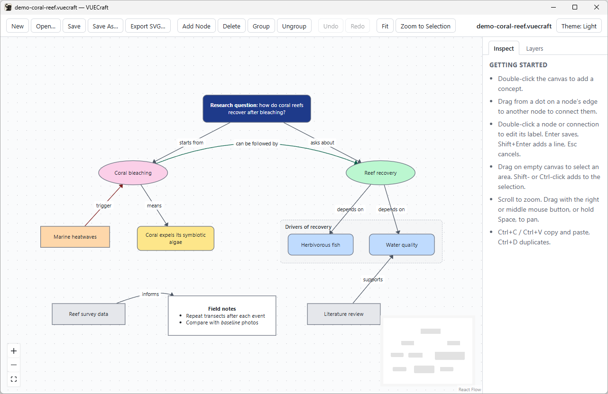
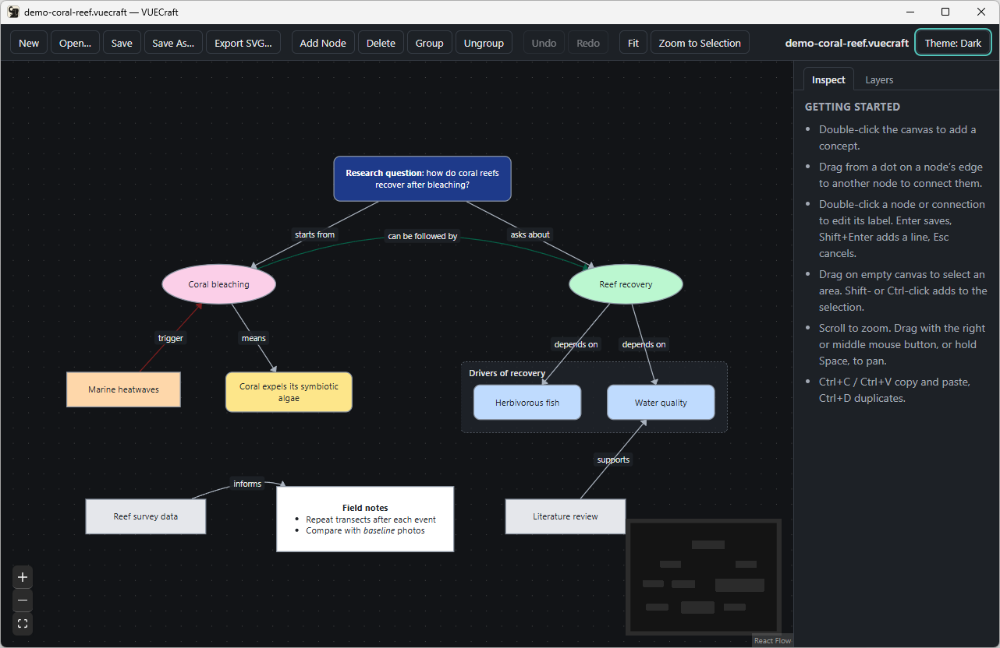
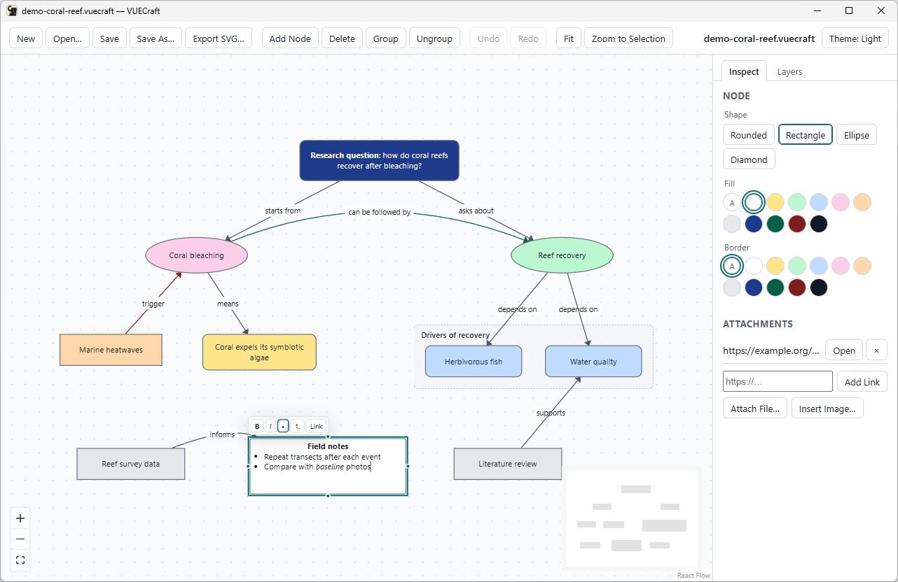

<p align="center">
  
</p>

<h1 align="center">VUECraft</h1>

<p align="center"><strong>The visual knowledge workbench.</strong></p>

<p align="center">
  An open-source, modern concept-mapping and visual research environment, powered by Rust.<br>
  Create, connect, organize, and explore ideas with groups, layers, rich text, images, and attachments.<br>
  Built for researchers, students, and anyone who thinks visually.
</p>

<p align="center">
  <a href="#license-and-credits"></a>
  <a href="#download-and-install"></a>
  <a href="#architecture"></a>
  
  <!-- CI badge: add it once the CI workflow has passed on GitHub. -->
</p>

<p align="center">
  <a href="#download-and-install"><strong>Download</strong></a> ·
  <a href="#features"><strong>Features</strong></a> ·
  <a href="#limitations"><strong>Limitations</strong></a> ·
  <a href="#building-from-source"><strong>Build from source</strong></a> ·
  <a href="#roadmap"><strong>Roadmap</strong></a> ·
  <a href="#contributing-and-bug-reports"><strong>Contributing</strong></a>
</p>



## Status

**v0.1.0-beta.1, the first public beta, for Windows 11 x64.** Everything listed
under Features is implemented and was tested on Windows 11. What this build
contains and how it was tested: [release notes](docs/RELEASE_NOTES_v0.1.0-beta.1.md),
[CHANGELOG.md](CHANGELOG.md), and per-feature evidence in
[docs/FEATURE_MATRIX.md](docs/FEATURE_MATRIX.md).

## Features

VUECraft is a local desktop app. You need no account, server or internet
connection to use it, and your maps are ordinary files on your disk.

**Build the map**

- **Concepts.** Double-click the canvas, or use **Add Node**. Edit a label in
  place: Enter saves, Shift+Enter adds a line, Esc cancels.
- **Links.** Drag from a concept's edge dots to another concept. Links attach
  to concept outlines, follow moves, and can carry their own labels.
- **Styling.** Four shapes (rounded, rectangle, ellipse, diamond) with fill and
  border colors. Links have a color, arrowheads (none, end, both) and straight
  or curved lines.
- **Groups.** Group the selection (Ctrl+G) and drag the group to move its
  contents. Ungroup with Ctrl+Shift+G. Deleting a group keeps its contents.
- **Layers.** Add, rename, reorder, hide, lock and delete layers, and move the
  selection to another layer. New content goes to the active layer.

**Add content**

- **Rich text.** Bold, italic, bulleted and numbered lists, line breaks and
  links, with Ctrl+B, Ctrl+I or the format bar shown while editing. Text is
  stored as structured content, not HTML. Pasted text keeps only these formats.
  Links in a map are never opened when it loads.
- **Attachments.** Add web links and references to local files. Missing files
  are flagged. A link opens in your browser, and a file is shown in its folder,
  only after you confirm.
- **Images.** Embed one image per concept: PNG, JPEG, GIF or WebP, up to 5 MB.

**Work with it**

- **Selection.** Click, Shift- or Ctrl-click, or drag a rectangle on empty
  canvas. Delete, copy (Ctrl+C), paste (Ctrl+V) and duplicate (Ctrl+D), keeping
  the links between copied concepts. Resize selected concepts.
- **Undo and redo** (Ctrl+Z, Ctrl+Y). Dragging several concepts is one step.
- **Viewport.** Scroll to zoom. Pan with the right or middle mouse button or
  Space+drag. Fit (Shift+1) and Zoom to Selection (Shift+2).
- **Themes.** Light, dark, or follow the system.

**Files**

- New, Open, Save and Save As. Saves are crash-safe, and unsaved changes get a
  Save / Don't Save / Cancel prompt, also when you close the window.
- Double-click a `.vuecraft` file in Explorer to open it.
- Maps are versioned JSON. Fields a version doesn't understand are kept and
  written back unchanged; files from a newer version are refused with an
  explanation.
- Export the whole map to SVG.

<table>
  <tr>
    <td></td>
    <td></td>
  </tr>
  <tr>
    <td align="center"><em>Dark theme</em></td>
    <td align="center"><em>Rich-text editing and attachments</em></td>
  </tr>
</table>

## Limitations

This is a beta. What it does not do yet:

- Windows 11 x64 only. macOS and Linux are not built or tested.
- The installer and app are not code-signed, so SmartScreen warns (see below).
- Rich text has no paragraph alignment.
- A concept grows taller to fit its text when you finish editing, but text can
  still be clipped if you later make the concept smaller or open a file whose
  text doesn't fit. Resize the concept to show it; nothing is lost.
- No search, align/distribute or automatic layout yet.
- No import of `.vue` files yet, no pathways or presentation mode, and no map
  merging.
- No PNG export. Copy and paste work only inside the app, not through the
  system clipboard.
- Attachment titles can't be edited, and a concept holds one image.
- SVG export estimates text width, so line wrapping can differ slightly from
  the canvas.
- Each double-clicked file opens in its own window.
- Large maps slow down: about 1,000 concepts drag at 12–15 fps (100 concepts:
  60 fps).

## Download and install

1. Download `VUECraft_0.1.0-beta.1_x64-setup.exe` from the
   [releases page](https://github.com/johnwallx/vuecraft/releases).
2. Check the file. In PowerShell, compute its SHA-256 and compare it with the
   checksum published with the release:

   ```powershell
   Get-FileHash "$HOME\Downloads\VUECraft_0.1.0-beta.1_x64-setup.exe" -Algorithm SHA256
   ```

3. Run the installer. It is not code-signed, so Windows SmartScreen shows
   *Windows protected your PC*. Choose **More info**, then **Run anyway**, but
   only for a file you downloaded from the official releases page and whose
   checksum matches.

| | |
|---|---|
| Requires | Windows 11 x64 and the Microsoft Edge WebView2 Runtime, which Windows 11 includes. If it is missing, the installer downloads Microsoft's WebView2 bootstrapper. |
| Installs | For the current user, without administrator rights, into `%LOCALAPPDATA%\VUECraft`. |
| Registers | The `.vuecraft` file type, so double-clicking a map opens it. |
| Uninstall | *Settings → Apps*. This removes the program and its file association and keeps your documents. |

## Building from source

You need Node 24+ with pnpm (via Corepack), stable Rust, and the
[Tauri 2 prerequisites](https://tauri.app/start/prerequisites/). On Windows
those are the Visual Studio C++ Build Tools and WebView2.

```bash
pnpm install
pnpm tauri dev        # run the app with hot reload
pnpm tauri build      # release executable and NSIS installer (target/release/bundle/nsis)
pnpm verify quick     # the quick check gate; `full` and `release` run more
```

Run `pnpm build` before calling `cargo` directly, because the desktop shell
embeds the built frontend (`dist/`). Every build, test and audit command is in
[AGENTS.md](AGENTS.md); how to propose changes is in
[CONTRIBUTING.md](CONTRIBUTING.md).

## Architecture

```text
React + React Flow UI (src/)  ──IPC──▶  Tauri 2 shell (src-tauri/)  ──▶  map-core engine (crates/map-core, Rust)
```

- **The Rust engine owns the document.** `map-core` (with Serde) holds the
  model, validation, undo/redo, file I/O and SVG export, and has no Tauri
  dependency.
- **Every edit is a validated, undoable transaction.** The engine applies all of
  its operations or none, records one undo step, and returns a fresh snapshot.
- **React Flow handles interaction.** Dragging, selection and zoom stay in the
  UI; a transaction is sent when a gesture ends, not on every pointer move.
- **IPC connects them** through Tauri commands. Tiptap (open-source edition)
  provides the rich-text editor.

Details, including the file format: [docs/ARCHITECTURE.md](docs/ARCHITECTURE.md).

## Roadmap

- Search, focus and highlight; align and distribute; automatic layout (in progress).
- Paragraph alignment in rich text.
- Import of legacy `.vue` maps, built from independently created test files.
- Pathways and a presentation mode.
- Map merging and structured metadata (tags, metadata search, CSV import).
- Code signing and macOS and Linux builds have not been started.

More in [ROADMAP.md](ROADMAP.md).

## Inspired by VUE

VUE, the Visual Understanding Environment, is a concept-mapping application
from Tufts University.

VUECraft is inspired by VUE's user-facing concept-mapping functionality. It is
implemented independently under a clean-room process and contains no VUE code.
It is not an official Tufts University or College of Charleston project and is
not endorsed by either. VUECraft is not part of ArtCraft or any "Crafting Apps"
family and is not affiliated with PDFCraft.

The rules, how they are enforced and their known limits are in
[docs/CLEAN_ROOM.md](docs/CLEAN_ROOM.md); the evidence used is logged in
[docs/PROVENANCE.md](docs/PROVENANCE.md). This record is the project's own
account, not a legal certification, and no independent review of it has been
done yet.

## License and credits

VUECraft is licensed under either of the [MIT license](LICENSE-MIT) or the
[Apache License, Version 2.0](LICENSE-APACHE), at your option. See also
[NOTICE](NOTICE).

| | |
|---|---|
| Third-party licenses | [THIRD_PARTY_NOTICES.md](THIRD_PARTY_NOTICES.md), also installed with the app |
| Provenance | [docs/PROVENANCE.md](docs/PROVENANCE.md) |
| Brand assets | [docs/brand/ASSETS.md](docs/brand/ASSETS.md). The elephant icon is interim artwork. |

VUECraft is built on [Tauri](https://tauri.app), [React](https://react.dev),
[React Flow](https://reactflow.dev), [Tiptap](https://tiptap.dev),
[Serde](https://serde.rs) and [Vite](https://vite.dev), among the other
open-source projects listed in the notices. Thanks to their authors.

VUECraft was developed under the working name Mapwright.

## Contributing and bug reports

- Read [CONTRIBUTING.md](CONTRIBUTING.md). Contributions must follow the
  clean-room rules in [docs/CLEAN_ROOM.md](docs/CLEAN_ROOM.md).
- Report bugs in [issues](https://github.com/johnwallx/vuecraft/issues).
- Ask questions and share ideas in
  [discussions](https://github.com/johnwallx/vuecraft/discussions).
- Report security problems as described in [SECURITY.md](SECURITY.md).
