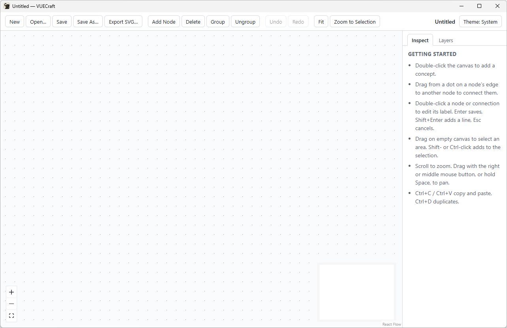
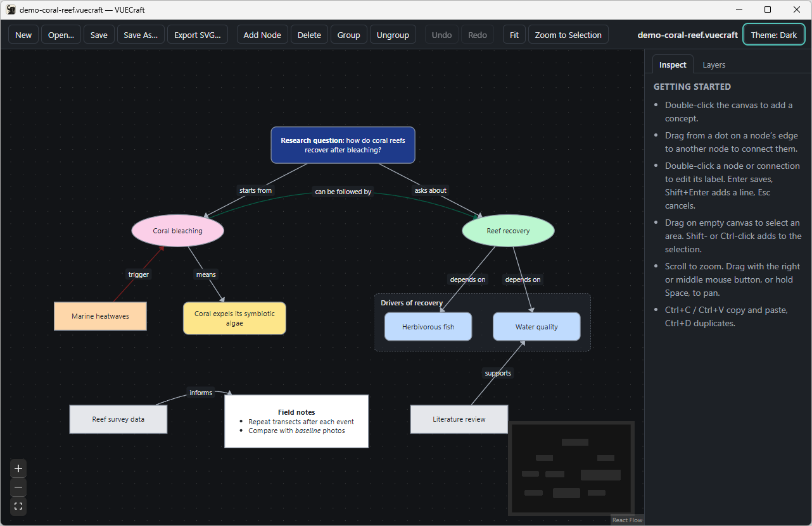

# Getting Started with VUECraft

*VUECraft v0.1.0-beta.1 for Windows 11. Reading time: about 7 minutes.*

VUECraft is a free, open-source desktop app for concept maps. You place ideas
(concepts) on a canvas and connect them with labeled links. It runs on your
computer, needs no account or internet connection, and keeps each map in a
single file.

This tutorial covers installing the beta, a tour of the window, and moving
around a map. After that, continue with
[Creating Your First Concept Map](02-first-concept-map.md) and
[Saving, Reopening, and Exporting Maps](03-save-reopen-export.md).

## What you need

- Windows 11, 64-bit (x64).
- The Microsoft Edge WebView2 Runtime. Windows 11 includes it. If it's
  missing, the installer downloads Microsoft's WebView2 bootstrapper, so stay
  online while you install.
- No administrator rights. VUECraft installs for your user account only.

## Install VUECraft

1. Open the [releases page](https://github.com/johnwallx/vuecraft/releases)
   and download `VUECraft_0.1.0-beta.1_x64-setup.exe`. To check the file in
   step 2, also download `SHA256SUMS.txt` from the same release.
2. Optional, but recommended: check that the download is complete and
   unmodified. Open PowerShell and run:

   ```powershell
   Get-FileHash "$HOME\Downloads\VUECraft_0.1.0-beta.1_x64-setup.exe" -Algorithm SHA256
   ```

   Open `SHA256SUMS.txt` in Notepad and compare the installer's checksum with
   the `Hash` value PowerShell printed. Every character must match (upper or
   lower case doesn't matter). If they differ, delete the download and don't
   run it.
3. Double-click the installer. The beta isn't code-signed, so Windows
   SmartScreen shows *Windows protected your PC*. Choose **More info**, then
   **Run anyway**. Do this only for a file you downloaded from the official
   releases page and whose checksum matches.

   <!-- screenshot-todo: SmartScreen "Windows protected your PC" dialog after clicking More info, with the Run anyway button visible -->

4. Follow the installer. It installs VUECraft into `%LOCALAPPDATA%\VUECraft`
   and registers the `.vuecraft` file type, so double-clicking a map opens it.
5. Start VUECraft. If you don't find it in the Start menu, press `Win+R`,
   paste `%LOCALAPPDATA%\VUECraft\vuecraft.exe` and press `Enter`.

VUECraft sends no data anywhere and doesn't check for updates. To get a newer
version, visit the [releases page](https://github.com/johnwallx/vuecraft/releases).

## Your first look

VUECraft starts with a blank map. The window title reads
`Untitled — VUECraft` and the canvas is empty.



The screenshot below shows the same window with the sample map open (see
[Explore the sample map](#explore-the-sample-map)).


### The toolbar

VUECraft has no menu bar. Every command is on the toolbar at the top. Hover
over a button to see what it does and its keyboard shortcut.

| Group | Buttons |
|---|---|
| Files | **New**, **Open…**, **Save**, **Save As…**, **Export SVG…** |
| Editing | **Add Node**, **Delete**, **Group**, **Ungroup** |
| History | **Undo**, **Redo** (grayed out when there's nothing to undo or redo) |
| View | **Fit**, **Zoom to Selection** |

On the right end of the toolbar you find:

- the name of the open map (`Untitled` until you save it);
- **● Unsaved changes**, shown while the map has changes you haven't saved;
- the theme button, for example **Theme: System** (see
  [Choose a theme](#choose-a-theme)).

### The side panel

The panel on the right has two tabs:

- **Inspect** shows the properties of whatever you select: shape, colors,
  link style and attachments. With nothing selected, it shows a list headed
  GETTING STARTED that sums up the basic mouse and keyboard actions.
- **Layers** lists the map's layers. A new map has one, **Layer 1**.

A note on wording: the side panel and the **Add Node** button call a concept
a *node*. These tutorials say *concept*.

### The canvas

The dotted area is the canvas. It has two helpers:

- **Zoom buttons** at the bottom left: **+** zooms in, **−** zooms out, and
  the frame button below them fits the whole map in view.
- **Minimap** at the bottom right: a small overview of the whole map. Drag
  inside it to move the view, or scroll over it to zoom.

## Move around a map

| To | Do this |
|---|---|
| Zoom in or out | Scroll the mouse wheel. The point under the pointer stays in place. |
| Pan | Drag with the right or middle mouse button, or hold `Space` and drag. |
| See the whole map | Click **Fit** or press `Shift+1`. |
| Zoom to selected concepts | Select them, then click **Zoom to Selection** or press `Shift+2`. |

Dragging with the left mouse button on empty canvas draws a selection box; it
doesn't pan. Zooming and panning never change the map itself.

## Choose a theme

Click the theme button at the right end of the toolbar to switch between
three settings:

1. **Theme: System** follows Windows' light or dark mode. This is the default.
2. **Theme: Light**.
3. **Theme: Dark**.

VUECraft remembers your choice. The theme changes only how VUECraft looks on
screen. It isn't saved in your maps, and SVG exports always have a white
background.



## Explore the sample map

The repository includes the map shown in the screenshots: a research question
about coral reef recovery, with labeled links, a group, formatted text and two
layers.

1. Open [demo-coral-reef.vuecraft](../assets/screenshots/demo-coral-reef.vuecraft)
   on GitHub and download it with the download button on the file page.
2. In VUECraft, click **Open…** (`Ctrl+O`) and choose the file. You can also
   double-click it in File Explorer, which opens it in a new window.
3. Try a few things:
   - Click a concept and look at the **Inspect** tab: its shape, colors and
     attachments.
   - Open the **Layers** tab and click **Hide** next to **Sources**. The
     source concepts and their links disappear. Click **Show** to bring them
     back.
   - Press `Shift+1` to fit the map in the window.

The sample's web links point to placeholder addresses on example.org, not to
real sources. It contains no attached files or images. Hiding a layer counts
as a change, so when you close the map, VUECraft asks whether to save it.
Choose **Don’t Save** to leave the sample as it was.

## Get help

- **Questions and ideas:** ask in
  [Discussions](https://github.com/johnwallx/vuecraft/discussions).
- **Bugs** (something doesn't work as documented): open an
  [issue](https://github.com/johnwallx/vuecraft/issues) with the **Bug report**
  form. Copy the exact text of any error message, because VUECraft keeps no
  log file. GitHub doesn't accept `.vuecraft` files, so zip a small sample map
  before you attach it. Everything you attach is public.
- **Security problems:** don't report them in public. Follow
  [SECURITY.md](../../SECURITY.md).

## Uninstall

1. Open **Settings → Apps → Installed apps**.
2. Find VUECraft, open its **…** menu and choose **Uninstall**.

Uninstalling removes the program and the `.vuecraft` file association. Your
maps stay where you saved them. Interface settings such as the theme can
remain in `%LOCALAPPDATA%\io.github.johnwallx.vuecraft`; delete that folder by
hand if you want them gone.

## Limitations in this beta

- Windows 11 x64 only. There are no macOS or Linux builds.
- The installer and app aren't code-signed, so SmartScreen warns before you
  install.
- All commands are on the toolbar. There is no menu bar.
- Each `.vuecraft` file you double-click opens in its own window.
- VUECraft can't import maps from other concept-mapping applications in this
  beta.

**Next:** [Creating Your First Concept Map](02-first-concept-map.md)
