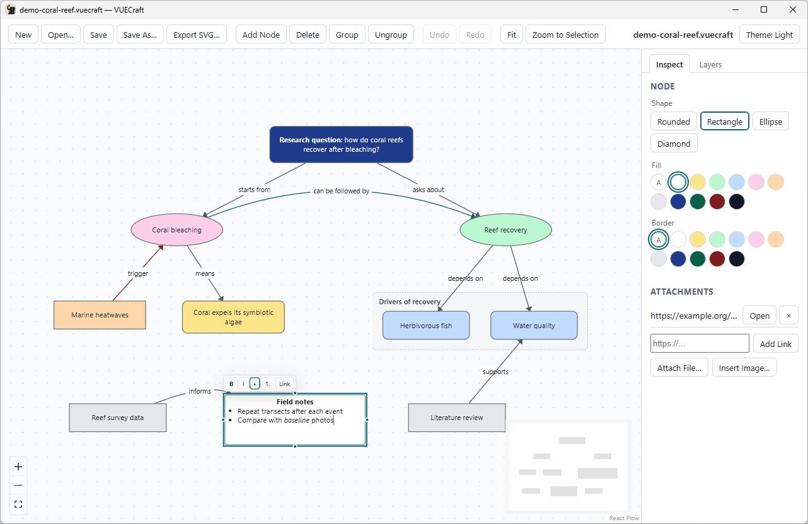

# Creating Your First Concept Map

*VUECraft v0.1.0-beta.1 for Windows 11. Reading time: about 10 minutes.*

In this tutorial you build a small research map around one question: *Does
sleep affect exam performance?* Along the way you create and connect
concepts, label links, style them, format text, group related ideas, use
layers, and attach sources.

Before you start, install VUECraft ([Getting Started](01-getting-started.md)).
If another map is open, click **New** (`Ctrl+N`) to get a blank one.

The side panel and the **Add Node** button call a concept a *node*. This
tutorial says *concept*.

## 1. Create concepts

1. Double-click an empty spot on the canvas. A concept appears there, with
   its text, `New concept`, already selected.
2. Type `Does sleep affect exam performance?` and press `Enter`.
3. Click **Add Node**. A new concept appears near the center of the view.
   Type `Method`, press `Shift+Enter` for a second line, type
   `Sleep diaries for two weeks`, and press `Enter`.
4. Add two more concepts the same way: `Evidence` and `Conclusion`.

While you type in a concept:

| Key | Effect |
|---|---|
| `Enter` | Saves the text |
| `Shift+Enter` | Starts a new line |
| `Esc` | Cancels and keeps the previous text |
| Click elsewhere | Saves the text |

To change the text later, double-click the concept, or select it and press
`F2` or `Enter`. When you finish typing, the concept grows taller if its text
needs more room.

## 2. Connect concepts

1. Hover over the question concept. Small dots appear on its four edges.
2. Drag from any dot to **Method**, and release over one of Method's dots
   (any of the four works). A link with an arrowhead appears, pointing at
   Method.
3. In the same way, connect **Method** to **Evidence**, and **Evidence** to
   **Conclusion**.

Links attach to the outline of each concept and follow when you move it.

<!-- screenshot-todo: dragging a new link from a dot on the question concept toward Method, with the dots visible on both concepts -->

## 3. Label links

A label turns a line into a statement you can read, such as *question* **is
tested by** *method*.

1. Double-click the link between the question and Method. You can also click
   the link to select it and press `F2` or `Enter`.
2. Type `is tested by` and press `Enter`.
3. Label the other two links `produces` and `supports`.

Link labels use the same keys as concept text (`Enter`, `Shift+Enter`,
`Esc`). They are plain text, without formatting.

## 4. Select, move, resize and delete

- **Select:** click a concept or link. To select several, drag a box on empty
  canvas (everything the box touches is selected), or `Shift`-click or
  `Ctrl`-click each item. Click empty canvas to clear the selection.
- **Move:** drag a concept. Dragging one selected concept moves the whole
  selection, and a single **Undo** puts it all back.
- **Resize:** select a concept and drag the handles on its corners and edges.
- **Delete:** press `Delete` or `Backspace`, or click **Delete**. Deleting a
  concept also deletes its links.

## 5. Style concepts and links

Select the question concept and open the **Inspect** tab. Under the NODE
heading you find:

- **Shape:** **Rounded**, **Rectangle**, **Ellipse** or **Diamond**.
- **Fill** and **Border:** rows of color swatches. The **A** swatch restores
  the default color.

Try it: give the question an **Ellipse** shape and a yellow fill. VUECraft
picks black or white text, whichever reads better on the fill. To style
several concepts at once, select them all; the heading then shows the count,
for example 3 NODES.

Now click the link from Evidence to Conclusion. The CONNECTION heading offers:

- **Color:** swatches, with **A** for the default.
- **Arrow:** **None**, **End** (the default) or **Both**.
- **Line:** **Straight** (the default) or **Curved**.

Set this link to **Curved** to see the difference.

## 6. Format text

Concept text can have bold, italic, lists and links. While you edit a
concept, a format bar appears above it:

| Button | Effect |
|---|---|
| **B** | Bold (`Ctrl+B`) |
| **I** | Italic (`Ctrl+I`) |
| **•** | Bulleted list |
| **1.** | Numbered list |
| **Link** | Makes the selected text a link |

Make a word bold:

1. Double-click **Evidence**. Its text is selected.
2. Press `Ctrl+B`, then `Enter`.

Make a list of limitations:

1. Double-click empty canvas to add a concept and type `Small sample`.
2. Click **•** on the format bar. The line becomes a bullet.
3. Press `Enter` to start a second bullet and type `Self-reported sleep`.
   Inside a list, `Enter` adds a bullet instead of saving.
4. Click outside the concept to finish.

Add a link to text:

1. While editing, select the words to link and click **Link**.
2. A field appears with `https://`. Complete the address and press `Enter`.
   Addresses must start with `http://`, `https://` or `mailto:`. `Esc`
   closes the field without changes.

To remove a link, click inside the linked text while editing, click **Link**,
clear the field and press `Enter`.

Links in concept text don't open when you click them on the canvas. To open
a source from VUECraft, attach it (step 9). When you paste formatted text from
another program, VUECraft keeps only bold, italic, lists and safe links.

## 7. Group related concepts

1. Add two concepts near Method: `Hours of sleep` and `Exam scores`.
2. Select both (drag a box around them, or `Shift`-click), then click
   **Group** (`Ctrl+G`). A box titled `Group` appears behind them.
3. Double-click an empty part of the group box, type `Measures` and press
   `Enter`.
4. Drag the group: both concepts move with it.

A selected group shows **Fill** and **Border** under the GROUP heading in
the **Inspect** tab. To ungroup, select the group or a concept inside it and
click **Ungroup** (`Ctrl+Shift+G`). Deleting a group keeps its concepts.

<!-- screenshot-todo: the Measures group selected with its two concepts inside, and the Inspect tab showing the GROUP heading with Fill and Border -->

## 8. Use layers

Layers keep kinds of content apart, so you can show or hide them together.
Here you put your sources on their own layer, so you can hide them when you
present the core argument.

1. Open the **Layers** tab. The list shows the top layer first. A new map has
   **Layer 1**.
2. Click **Add Layer**. **Layer 2** appears and becomes the active layer
   (highlighted). New concepts, links and pasted items go to the active
   layer. To make another layer active, click its name.
3. Double-click **Layer 2**, type `Sources` and press `Enter`.
4. Add two concepts, `Literature review` and `Survey data`, and connect
   **Literature review** to **Evidence** with the label `informs`.
5. Click **Hide** next to Sources. Its concepts and links disappear. Click
   **Show** to bring them back.

The other buttons on each layer:

| Button | Effect |
|---|---|
| **Lock** / **Unlock** | A locked layer stays visible, but its items can't be edited. |
| **↑** / **↓** | Raise or lower the layer in the stack. |
| **Move Here** | Moves the selected items to this layer. Select them on the canvas first. |
| **Delete** | Deletes the layer. If it holds items, VUECraft asks first; confirm with **Delete Layer**. The items move to the next layer down (or up, for the bottom layer). |

The number next to each layer name counts its items. Hidden layers are
skipped by selection, **Fit** and SVG export.

If the active layer is hidden or locked, VUECraft won't add new content to it
and explains why in a red banner. Click the name of a visible, unlocked layer
and try again.

<!-- screenshot-todo: Layers tab with Sources above Layer 1, Sources highlighted as the active layer, showing the Hide, Lock, arrow, Move Here and Delete buttons -->

## 9. Attach sources

A concept can carry up to 20 attachments: web links and references to files
on your computer. Select exactly one concept and look under ATTACHMENTS in the
**Inspect** tab.

Add a web link:

1. Select **Literature review**.
2. Type the address in the field that shows `https://…`, for example
   `https://example.org/sleep-review`, and click **Add Link** (or press
   `Enter`). Addresses must start with `http://`, `https://` or `mailto:`.

Attach a file:

1. Select **Survey data**.
2. Click **Attach File…** and choose a file, for example your data
   spreadsheet.

VUECraft stores only the file's location; it doesn't copy the file into the
map. If you later move, rename or delete the file, the attachment shows
"File not found".

Use the buttons next to each attachment:

- **Open** (web link): VUECraft asks *Open link?* Click **Open Link** to open
  the address in your web browser.
- **Show** (file): VUECraft asks *Show file?* Click **Show in Folder** to open
  File Explorer with the file selected. VUECraft never opens or runs the file
  itself.
- **×** removes the attachment.

<!-- screenshot-todo: the "Open link?" confirmation dialog with its Cancel and Open Link buttons -->

## 10. Add an image

1. Select one concept, for example a new concept `Sleep stages chart`.
2. In the **Inspect** tab, click **Insert Image…** and choose a PNG, JPEG,
   GIF or WebP file of up to 5 MB.

The image is embedded in the map, so it travels with the file. A concept
holds one image, and a small concept grows to make room for it. While a
concept has an image, the button reads **Remove Image**. If the file is too
large or isn't one of these image types, a red banner says so.

## 11. Copy, paste and duplicate

- `Ctrl+C` copies the selection and `Ctrl+V` pastes it. Each paste lands
  slightly below and to the right of the previous one.
- `Ctrl+D` duplicates the selection in one step.

Links between the copied concepts come along, and copying a group copies its
concepts. Pasted items go to the active layer.

## 12. Undo and redo

- **Undo** (`Ctrl+Z`) and **Redo** (`Ctrl+Y` or `Ctrl+Shift+Z`).
- Hover over **Undo** or **Redo** to see which action it affects, for
  example *Undo Connect (Ctrl+Z)*.
- VUECraft keeps your last 500 steps.
- While you type in a concept, `Ctrl+Z` undoes typing. The whole edit becomes
  one step when you finish.
- An edit on a layer that is now locked can't be undone. Unlock the layer
  first.

Your map is ready. Save it with **Save** (`Ctrl+S`); the next tutorial
explains saving in detail.

## Limitations in this beta

- No automatic layout, align and distribute, or search. Arrange concepts by
  hand.
- Arrow keys don't move concepts. Drag them with the mouse.
- A link's ends can't be moved to another concept. Delete the link and draw a
  new one.
- Groups can't contain other groups, have no resize handles (they fit their
  contents), and can't be linked. Link the concepts inside instead.
- Text has no paragraph alignment.
- Text can be cut off if you make a concept smaller after typing, or in a map
  you open. Resize the concept to show it; nothing is lost.
- Attachment titles can't be edited, and a concept holds one image.
- Copy and paste work only inside one VUECraft window. They don't reach other
  apps or other VUECraft windows.

Questions? Ask in [Discussions](https://github.com/johnwallx/vuecraft/discussions).

**Previous:** [Getting Started with VUECraft](01-getting-started.md) ·
**Next:** [Saving, Reopening, and Exporting Maps](03-save-reopen-export.md)
